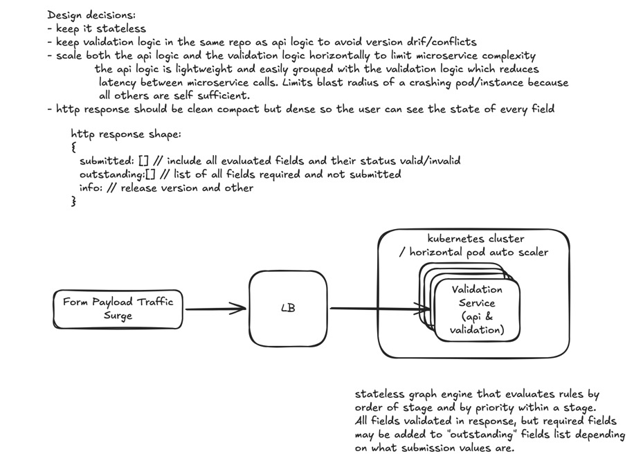
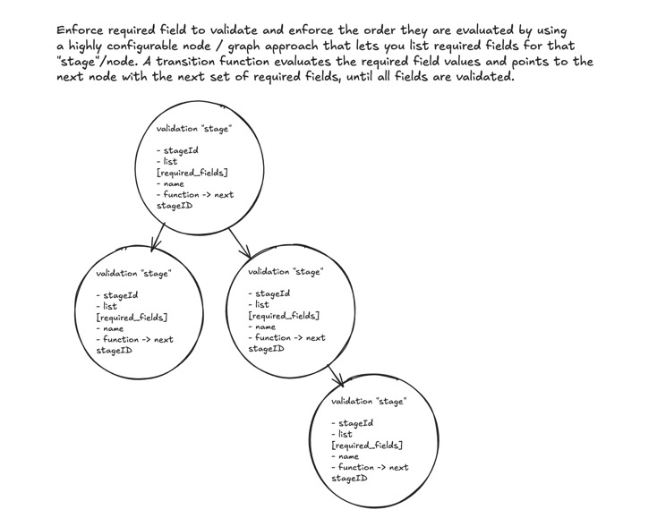

# Overview
This engine is designed to go far beyond traditional form validation. Rather than simply evaluating a static bulk set of rules, its core capability is to dynamically determine which fields need or don't need to be validated as the user progresses through the workflow configured in "stages".

Built to support highly customizable forms where requirements change drastically based on prior answers, the system utilizes a stateless graph-walking architecture. The form is structured as a network of stages (nodes), where each node explicitly defines its own validation requirements.

Upon receiving a cumulative payload of all answered fields, the engine validates the current stage/node, evaluates the inputs, and runs a transition function to determine the next stage/node in the graph. This allows entire sections of the form to appear, disappear, or shift their validation rules on the fly depending on user responses and the configuration in stages.py.

Architectural Rationale & Design Trade-Offs
For simpler forms with fixed paths, a traditional linear validator would be more than sufficient. However, this graph-based solution was deliberately selected to solve complex, multi-branching requirements (such as financial aid applications) where downstream fields depend entirely on upstream conditional logic.

# Architectural / Design Decision Record

## 1. Monorepo Structure & Co-Located Validation Logic
* **Unified Codebase:** I chose a single monorepo layout using all Python to keep the FastAPI service, core graph engine, YAML configurations, and Python rule scripts physically adjacent.
* **Elimination of Version Drift:** By co-locating the business rules directly inside the API container image, we eliminate the risk of version mismatch or drift between an independent rule microservice and the API consumption layer.
* **Auditability via Version Control:** Because the code and rules live together in version control, any production bug report or frontend validation issue can be traced back to an exact Git commit SHA, allowing engineers to view the exact rules that were active at that precise timestamp. This is also possible for our front end client engineers because or API respnoses include the release version currently running.

## 2. In-Process Execution & Unified Scaling
* **Zero Network Hop Overhead:** Rules validation executes completely in-process. When an HTTP request hits FastAPI, it invokes the local Python rule scripts in-memory, avoiding a network hop per validation or managing calls between microservices.
* **Co-Located Scaling:** Rather than scaling an independent rule-evaluation service separately, the API and validation logic scale as a single unit. Because the FastAPI application layer is lightweight, horizontal scaling is unified and predictable. This makes our architecture more resilient because it avoids having an entire rule evaluation flow paralyzed because one microservice went down.
* **Kubernetes Traffic Triggers:** Replicas can scale independently with traffic because each request carries its own state. Kubernetes can scale horizontally by monitoring traffic levls. 

## 3. Client-Side Version Visibility in API Responses
* **Semantic Versioning (`major.minor.patch`):** The API response payload returns the active application build version inside the `info` metadata block. This is crucial because it allows our client side front end engineers to pinpoint the exact validation rule versions their code was interfacing with.
* **Telemetry & Debugging:** This enables frontend clients, logging systems, and error monitoring tools to explicitly record and verify the exact backend rule version that validated a user's session data, ensuring absolute traceability during audits or client support escalations.

## 4. Declarative Rule Catalog (`rule_field_catalog.yaml`)
* **Human-Readable Configuration:** We centralized incoming API call field definitions, parameterized rule definitions, and field-to-rule bindings inside a clean, human-readable YAML configuration file (`rule_field_catalog.yaml`).This is extentable and allows engineers to more easily comprehend and debug rule mappings across release versions. It's extendable, simple and testable.
* **Decoupled Business Logic:** This declarative separation allows developers and compliance teams to inspect or adjust validation bindings without refactoring core engine plumbing, while keeping Python's module path notation (`rules.module:function`) as the clean execution reference. Note: because changing the rule_field_catalog.yaml changes application logic, it should also come with an new release version update.

## 5. Stage-Based Evaluation & Stateless Architecture (`stages.py`)
* **Stateless Cumulative Payload Transmission:** The architecture is strictly **stateless**. The server never maintains session state or tracks user progress in memory. On every API call, the client transmits the complete, cumulative dictionary of *all* form fields answered across all steps so far.
* **Map-Based Graph Nodes (`stages.py`):** Stages are modeled as nodes in a directed graph stored in a Python dictionary rather than a rigid array. Each stage node explicitly defines:
  1. Its **`required_fields`** that must be present and valid to clear the stage.
  2. A **`transition`** (a modular Python function pointer) that inspects the validated required fields of that stage to dynamically determine the next stage ID.
* **Stateless Graph-Walking & Dynamic Branching:** On every incoming request, the engine starts at the root node and walks the graph:
  * It validates and then evaluates the required fields for the current stage against those fields provided in the cumulative payload.
  * If any required fields are missing (surfaced in `outstanding`) or invalid (surfaced in `submitted`), execution halts immediately, returning the validation breakdown and remaining requirements. We halt immediately because it is not possible to know the next stage (and future required fields) until after the user successfully clears the current stage. However, all fields are validated with their appropriate rules regardless of if we have raeach their stage yet (said another way, we validate all fields, even if they are "early").
  * Once all required fields for the stage are valid, the engine executes that stage's transition function to dynamically compute the next stageId in the graph.
* **Client-Side State Inference:** Because the full cumulative payload is re-evaluated statelessly on every request, the backend simply returns the atomic `submitted` results and `outstanding` fields. The frontend client infers completion, error states, and navigation routing so the user can supply corrected or missing fields on the fly.
* **Loose Coupling with Frontend Logic:** Because the backend engine is completely stateless and agnostic of presentation, it has zero knowledge of UI "pages," "tabs," or "steppers." It only evaluates data fields against rules and gates. This frees the frontend team to render the form in any layout they prefer—whether a single-page scrolling form, a tabbed dashboard, or a non-linear wizard—without backend refactoring.
* **Complete Frontend Transparency:** The minimalist response structure (submitted and outstanding) gives the client absolute transparency into the application's state. The frontend state machine doesn't rely on opaque backend session tokens; it reads the raw data contract directly, allowing it to dynamically enable/disable inputs, render progress indicators, or route users to different sections based entirely on what data is missing or invalid or deemed no longer necessary.
* **Zero UI-Driven API Changes:** Rearranging form steps or redesigning user workflows on the client side requires zero modifications to the backend engine or API contract, as long as the client continues to transmit the cumulative payload of required fields. The whold design is driven by intuitive readable configurations.
* **Circularity Checking:** There is the possiblilty of circularity bugs when using a graph design like this. These would be easy enough to check for in a dedicated test suite that would utilize graph algorithms and circularity checking aglorithms similar to the ones illustated in leetcode problems "287. Course Schedule" and "287. Find the Duplicate Number". I did not have time to implement any of these tests in this submission, but I easily could if this was a fully implementation.

## 6. Kubernetes Deployments, Canary Testing, and Rollbacks
* **Rolling Updates & Zero Downtime:** Kubernetes deployment strategies enable gradual rolling updates, ensuring zero downtime for users interacting with active FAFSA sessions during deployments.
* **Canary Testing Support:** Traffic can be split safely across container versions to test rule changes against live traffic subsets.
* **Instant Rollbacks:** If a regression is detected in a rule script, Kubernetes allows teams to instantly roll back to the previous immutable container image tag with a single command.

## 7. Testing Strategy & Production Validation
* **Demonstration vs. Production Test Suites:** The initial unit tests implemented for this engine (under tests/rules/) serve primarily as demonstration and smoke-testing harnesses to verify that individual rule scripts correctly and to reach the required test coverage.
* **Limitations of Manual Test Cases:** Hand-crafted unit tests only cover developer-anticipated scenarios and fail to capture the vast combinatoric complexity, subtle cross-field edge cases, and unexpected data variations found in real-world user submissions.
* **Data-Driven Test Generation:** True test coverage for large-scale, multi-branch user forms should be driven by analyzing hundreds or thousands of anonymized historical user data samples.
* **Consolidation and Edge Case Profiling:** Real user data submissions should be used to validate the quality of our tests and to help identify unforseen edge cases. Test coverage alone is not a measure of test quality.

## 8. Application status and field results

The assessment explicitly requests an overall status. Clients can derive it from the details. Any invalid submitted result gives `INVALID`, otherwise missing required fields give `INCOMPLETE`, otherwise the application is `VALID`. An absent conditional field appears in `outstanding` until supplied. Each submitted result identifies the field, rule, severity, and any correction message.

**Disclaimer:**

My opinions on all these decisions are still not fully formed since this was such a short assignement. There are undoubtedly better ways to do this that will wake up in the middle of the night. IMO tech leads should have enough experience to form a solid design but they confidence should be coupled with the humility to revisit those opinions and change them. Every design decsision is a tradeoff, generally speaking I try to lean towards simplicity and readability whenever possible.

# Early Brainstorming

